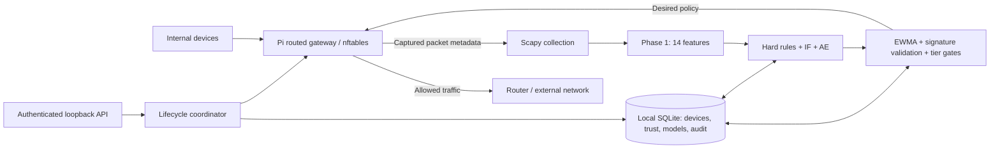

# Phase 2 implementation plan and migration map

## Target architecture

The supplied Phase 2 diagram becomes a local-only gateway. Its cloud update/monitoring branch is removed. Every decision and model update happens on the Pi; external connectivity is used only for allowed device traffic and any explicitly configured ordinary DNS resolution.

The current behavior monitor retains Phase 1 packet-window features. The diagram's “flow-level metadata” is a conceptual boundary; no NetFlow/IPFIX collector or new flow-feature model is claimed. Changing to flow aggregation later must preserve the 14-feature contract or train/version a separate model deliberately.

## Phase 1 carry-over map

Reference commit: `ae8ecc7f64e1b0838dd13f7281ee53bdca143c75` in [TrustEdge-firewall](https://github.com/nehadevarasetty/TrustEdge-firewall). The source is read-only and has not been pushed.

| Phase 1 responsibility | Phase 2 implementation | Status / boundary |
| --- | --- | --- |
| Scapy LAN packet monitoring | `collection.py` | Explicit registered devices, bounded metadata buffers, no synthetic fallback |
| Ordered 14-feature extraction | `features.py` | Preserved; offline parity oracle |
| Per-device scaler + IsolationForest | `detection.py` | Preserved parameters, calibration, local training |
| MLP autoencoder suppression | `detection.py` | Preserved architecture, training and scoring |
| Rolling model refit | `detection.py` | Local rolling buffer and calibration anchors persist |
| Hard rules including VPN ports | `detection.py` | Preserved thresholds; also checked during learning |
| Adaptive SignatureStore | `signatures.py` | Same 10/20/30 milestones and validation scales; streaming moments replace unbounded vector storage |
| Asymmetric EWMA / tiers | `trust.py` | Noise floor and AE recovery preserved; three-window downgrade, ten-window recovery |
| iptables enforcement | `policy.py` | Replaced with atomic owned nftables table, checked return codes, interface restrictions |
| Scattered memory/JSON/joblib state | `storage.py` | SQLite device state, model bundles, signatures, counters and audit |
| Enrollment / deletion / rebaseline | `registry.py`, `service.py` | Explicit and serialized; durable intent, generation checks, no silent policy upgrade |
| REST API | `api.py` | Local lifecycle/status/events endpoints; loopback bearer authentication |
| Simulation containers / generators | `simulation.py` | Explicit offline fixtures, separate simulation database and policy adapter |
| Docker Compose network and router | Pi OS routing + rendered deployment artifacts | No Docker dependency |
| DHCP/DNS | Rendered dnsmasq configuration | Local service, reservations; explicit optional DNS upstreams |
| Cloud API, Supabase, SMTP, telemetry | Omitted | No cloud credentials, upload worker or model-fetch job |
| Phase 1 dashboard | `static/`, `dashboard.py` | New local seven-area console with polling, trust/traffic history, safe lifecycle controls; no cloud assets |
| Phase 1 role accounts | Deferred | Local bearer-token operator access; per-user RBAC not implemented |
| Evaluation scripts / attack containers | Tests and future hardware evaluation | No automatic attacks are sent to a real network |

No trained weights were found in GitHub. The import tool can load separately saved trusted Phase 1 artifacts; otherwise new local weights are trained using the preserved algorithm. This does not reproduce old trained weights from source code alone.

## Deliberate safety differences

- New and learning devices are CAUTIOUS; deleted/unknown devices cannot forward. No management-IP detection exemptions are carried over.
- Hard-rule detections retain score 1.0, force trust to 0.1, and quarantine immediately (Phase 1 parity). Non-hard ML transitions proceed one tier at a time after three consecutive anomalous windows (TRUSTED → CAUTIOUS → QUARANTINE). Existing connections do not bypass confirmed restrictions. See [POLICY_CORRECTIONS.md](POLICY_CORRECTIONS.md).
- Phase 1's signature thresholds (.70 → .65 → .55 → .50), severity probes and three-window streak-saturation bypass are retained. Signature validation operates only on vectors in memory, not synthetic network traffic. Counts, streaming centroid/variance, milestone and threshold persist and reset on rebaseline.
- Quarantine cannot teach a normal baseline or recover automatically from empty/restricted traffic. An audited operator-release action is available via the local dashboard and API. Rebaseline preserves quarantine and trust.
- Desired tier is persisted before applying policy; the last confirmed applied tier changes only after success. Tombstones and model generations make lifecycle operations retryable across restart.
- IPv6 is denied on the IoT forwarding path until there is a complete IPv6 device identity and policy implementation. Routed same-LAN traffic is covered; peers communicating directly at layer 2 require switch/AP isolation.

## Development and acceptance order

### 1. Backend foundation — implemented and tested locally

Run the full ordinary suite: Phase 1 parity, IF/AE persistence, adaptive signatures, enforcement failures, migration/rebaseline/deletion, API authentication, configuration validation, deployment rendering and preflight diagnostics. Simulation remains a separate mode and database. No runtime code uploads telemetry or fetches models.

### 2. Linux network validation — test harness written, execution pending

Run opt-in tests on a dedicated Linux/Pi environment. They create a disposable outer network namespace and client/WAN child namespaces; host interfaces/firewall are untouched. Verify nft syntax, atomic rollback and real packet paths. Install `nftables`, `iproute2`, `util-linux` and Python dependencies first. Test commands are in the deployment guide. A failure must be investigated rather than converted to a skip.

### 3. Pi commissioning — pending hardware

Confirm OS/interface names; configure USB Ethernet LAN and built-in Ethernet WAN; load reviewed generated files; verify deny-before-forwarding startup; check real DHCP reservations, local DNS, NAT, each tier, restart and actual reboot. Confirm external router ports do not provide a bypass for test clients. Record acceptance results, kernel/nft/Scapy/package versions, traffic rates and power behavior.

### 4. Operator workflow — next backend work

The local dashboard, destination update action and explicit audited CAUTIOUS release are implemented. Validate browser interactions, IP/MAC reservation handling and concurrent operations; evaluate whether per-user RBAC is required. Keep token authentication on loopback or use an SSH tunnel; adding remote management requires a separate access-control design.

### 5. Device evaluation — pending real traffic

Collect approved clean baselines for each physical device and compare detection/false-positive rates against Phase 1. Measure capture drops, CPU/RAM, SD-card writes, inference/training latency and forwarding throughput on Pi 4. Hard rules currently run at the 60-second window boundary; do not report zero-latency enforcement. Optimize scheduling/retention only with measurements and parity tests.
